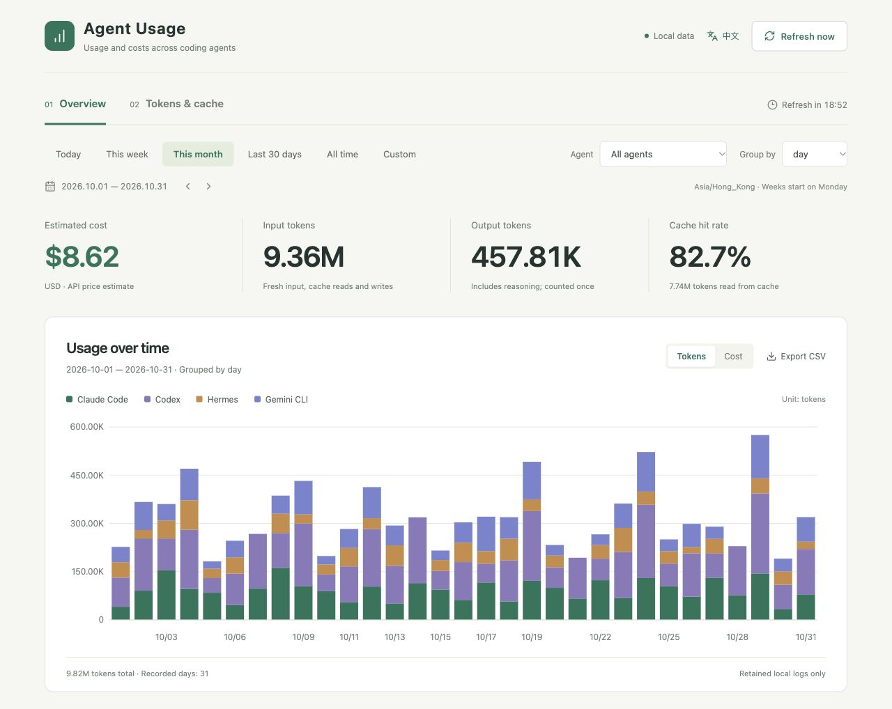

# agentusage · 用量手账

[简体中文](README.zh-CN.md) · English

A local dashboard powered by [ccusage](https://github.com/ccusage/ccusage). Track input and output tokens, cache reads and writes, cache hit rates, and estimated USD costs across every agent supported by the installed ccusage version.

## UI preview



Screenshot uses synthetic demonstration data. It contains no real user usage, accounts, or credentials.

## Quick start

Use **Node.js 22.12+ and npm**, or **Bun** (verified with Bun **1.4.3**). No API key, database, or hosted account is required.

### One-line install for macOS

Run in Terminal:

```sh
bash -c 'set -o pipefail; curl -fsSL https://raw.githubusercontent.com/jhosonjames11/agentusage/main/scripts/install-macos.sh | bash'
```

The installer downloads the project, installs dependencies, builds it, and starts the dashboard. The default location is `~/Library/Application Support/AgentUsage/app`. It uses an existing Node.js 22.12+ and npm when available; otherwise it downloads and verifies a private Node.js runtime without changing the system installation. Apple Silicon and Intel Macs are supported. Internet access is required; the downloaded Node.js runtime requires macOS 13.5 or later.

After installation, double-click `启动看板.command` / `停止看板.command` in the installed directory to start or stop the dashboard. If a dashboard is already running on port 4320, the launcher reuses it; if another application occupies the port, resolve that conflict first. The installer refuses to overwrite an existing installation, so rerunning it does not automatically update existing files or data.

### With Node.js and npm

Clone the repository and start the dashboard:

```sh
git clone https://github.com/jhosonjames11/agentusage.git
cd agentusage
npm ci
npm run build
npm run open
```

Open **http://127.0.0.1:4320/**. `npm run open` starts a background service and opens your browser; it reuses an existing dashboard service. Use `npm run open -- --no-open` to start without opening a browser, `npm run status` to check it, and `npm run stop` to stop it. On macOS, you can also double-click `启动看板.command` / `停止看板.command` after installation and building.

### With Bun

Install [Bun](https://bun.sh/docs/installation), then run:

```sh
git clone https://github.com/jhosonjames11/agentusage.git
cd agentusage
bun install --frozen-lockfile
bun --bun run build
bun --bun run open
```

Open **http://127.0.0.1:4320/**. Bun imports the committed `package-lock.json` on the first install and generates a local `bun.lock`.

Use `--bun` to run the existing scripts with the Bun runtime, including the background service and ccusage subprocess. Without this flag, the `node` commands in the package scripts still use Node.js.

```sh
bun --bun run open --no-open  # start without opening a browser
bun --bun run status         # check the background service
bun --bun run stop           # stop the background service
```

For a foreground service, use `bun --bun run start`. For frontend development, run `bun --bun run dev` in another terminal. Set a custom port with `USAGE_DASHBOARD_PORT=4322 bun --bun run open`; use the same port for `status` and `stop`.

The macOS double-click launchers and the `npm test` suite use Node.js; use the Bun commands above to run the dashboard with Bun alone.

The service collects on startup and every **20 minutes**, including while the browser is closed. Manual refresh restarts the 20-minute deadline. Start it again after restarting your computer.

## Features

- **Chinese / English:** select **English** or **中文** in the header. Your choice is remembered; switching preserves the current filters and chart view. CSV headers follow the selected language.
- **All agents:** select an individual agent or all agents. The selector separates agents with local history from those without it. Charts show agents recorded in the selected period.
- **Date ranges:** today, this week, this month, last 30 days, all retained history, or custom dates. Navigate earlier days, weeks, and months with the arrows.
- **Daily / weekly / monthly grouping:** metrics, charts, model breakdowns, and tables use the same filtered records.
- **Tokens and costs:** stacked usage charts, cost trends, cache composition, agent contributions, model usage, and period details.
- **CSV export:** export the selected dates, agent, and grouping, with a UTF-8 BOM for spreadsheet applications.

The initial interface is Chinese. Dates use **Asia/Hong_Kong** and weeks start on Monday. Edge weeks and months include only the selected dates. Relative ranges roll forward at midnight; historical and custom ranges stay fixed.

## Supported agents

The pinned **ccusage 20.0.48** release currently exposes these 18 source namespaces:

| Namespace | Agent | Namespace | Agent |
| --- | --- | --- | --- |
| `claude` | Claude Code | `codex` | Codex |
| `opencode` | OpenCode | `amp` | Amp |
| `droid` | Droid | `codebuff` | Codebuff |
| `hermes` | Hermes | `pi` | pi-agent |
| `goose` | Goose | `kilo` | Kilo |
| `copilot` | GitHub Copilot CLI | `gemini` | Gemini CLI |
| `antigravity` | Antigravity | `kimi` | Kimi |
| `qwen` | Qwen | `openclaw` | OpenClaw |
| `grok` | Grok Build CLI | `zcode` | ZCode |

Supported namespaces are discovered from `ccusage --help`. New namespaces appear automatically after upgrading ccusage if its unified report schema remains compatible. Agents with no local logs show an empty state. An agent mentioned in upstream documentation but absent from the installed CLI is not advertised as supported.

One unified report is collected per refresh:

```sh
npx --no-install ccusage daily --by-agent --json --offline --timezone Asia/Hong_Kong
```

Log detection and environment variables such as `CODEX_HOME` and `HERMES_HOME` are handled by ccusage. Set any custom locations before starting the service. Restart the service after changing its environment.

## How numbers are calculated

```text
Total input = fresh input + cache reads + cache writes
Cache hit rate = cache reads / total input
```

Cache writes are not hits. Reasoning already included in output is not added again. The reported `totalTokens` is preserved when available; otherwise total tokens are the sum of input and output. Some agents record incomplete token categories, so category sums may differ from reported totals. Earlier Codex reports with inclusive `cachedInputTokens` are also supported. No input means no calculable hit rate, displayed as `—`.

USD amounts come directly from ccusage using its bundled model prices. **These are API price estimates, not subscription bills or provider invoices.** Missing prices remain unavailable or are labelled as a known portion. Model aliases, pricing tiers, custom providers, and retained log coverage affect accuracy.

## Refresh, storage, and privacy

- The local service owns the timer. The visible browser reads the cached snapshot every 15 seconds without running ccusage again.
- Concurrent refresh requests share one collection. A failed unified collection retains previous successful data and marks it stale. If ccusage emits warnings and a recorded source disappears, its prior data is retained until a clean report confirms the empty history.
- `.data/usage.json` stores aggregate usage and model names, not conversation content. `.data/server.log` stores service logs. Both are ignored by Git.
- The server binds to `127.0.0.1`, validates Host and Origin, and serves only built frontend files and aggregate API responses. It does not expose raw session files or credentials.
- Only retained logs on this computer are included. Remote, unsynced, and deleted histories are not reconstructed.

## Development

```sh
npm start            # foreground data service, port 4320
npm run dev          # in another terminal: Vite, port 4321
npm test
npm run build
```

The development server proxies `/api` to the local data service. Rebuild after frontend edits; stop and restart after server edits. To use a different production port:

```sh
USAGE_DASHBOARD_PORT=4322 npm run open
USAGE_DASHBOARD_PORT=4322 npm run stop
```

Tests cover per-agent unified normalization, double-count prevention, missing prices, source discovery, language persistence and CSV translation, date boundaries, filtering, empty data, failure recovery, concurrency, and the 20-minute scheduler. Architecture and validation details are in [docs/design.md](docs/design.md).

## License

The dashboard's original code is licensed under [MIT](LICENSE).

This independently maintained project is powered by [ccusage](https://github.com/ccusage/ccusage), created by [ryoppippi](https://github.com/ryoppippi). ccusage is MIT-licensed, with `Copyright (c) 2025 ryoppippi`. Its complete license is preserved in [licenses/ccusage-MIT.txt](licenses/ccusage-MIT.txt); see [THIRD_PARTY_NOTICES.md](THIRD_PARTY_NOTICES.md) for attribution and distribution notes.

ccusage and other dependencies retain their own licenses. This dashboard is not an official ccusage product.
