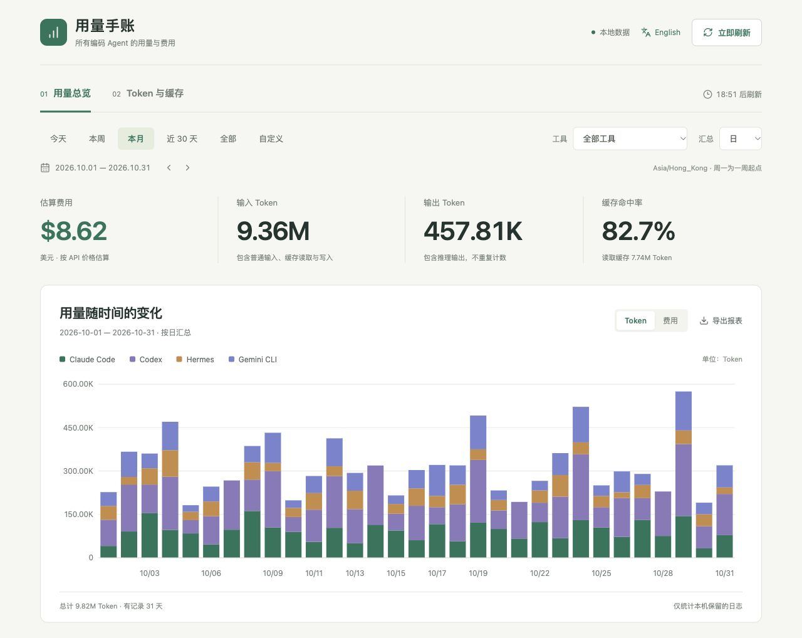

# 用量手账 · agentusage

简体中文 · [English](README.md)

基于 [ccusage](https://github.com/ccusage/ccusage) 的本地用量看板，支持已安装 ccusage 的全部 Agent。查看输入 / 输出 Token、缓存读取 / 写入、缓存命中率和美元估算费用，可手动切换中英文。

## 界面预览



截图全部使用模拟演示数据，不包含真实用户用量、账户或密钥。

## 安装与启动

可使用 **Node.js 22.12+ 和 npm**，或 **Bun**（已验证 **1.4.3**）。无需 API Key、数据库或云端账户。

### 使用 Node.js 和 npm

克隆仓库后，在项目目录运行：

```sh
git clone https://github.com/jhosonjames11/agentusage.git
cd agentusage
npm ci
npm run build
npm run open
```

打开 **http://127.0.0.1:4320/**。启动器会复用已有服务；`npm run open -- --no-open` 可只启动后台服务。查看状态：`npm run status`；停止：`npm run stop`。macOS 安装并构建后，也可双击 `启动看板.command` / `停止看板.command`。

### 使用 Bun

安装 [Bun](https://bun.sh/docs/installation)，然后运行：

```sh
git clone https://github.com/jhosonjames11/agentusage.git
cd agentusage
bun install --frozen-lockfile
bun --bun run build
bun --bun run open
```

打开 **http://127.0.0.1:4320/**。首次安装时，Bun 会导入仓库中的 `package-lock.json`，并在本地生成 `bun.lock`。

`--bun` 会让现有脚本使用 Bun 运行，包括后台服务和 ccusage 子进程；省略该参数时，脚本中的 `node` 命令仍使用 Node.js。

```sh
bun --bun run open --no-open  # 只启动后台服务，不打开浏览器
bun --bun run status         # 查看后台服务状态
bun --bun run stop           # 停止后台服务
```

前台运行：`bun --bun run start`。开发前端：另开终端运行 `bun --bun run dev`。更换端口：`USAGE_DASHBOARD_PORT=4322 bun --bun run open`，查询状态和停止时使用同一个端口。

macOS 双击启动脚本和 `npm test` 测试套件使用 Node.js；仅安装 Bun 时，使用上面的 Bun 命令运行看板。

启动立即采集，此后每 **20 分钟** 自动采集。浏览器和启动终端关闭后，后台服务继续运行。手动刷新后重新计时；重启电脑后需要重新启动服务。

## 功能

- **语言切换：**右上角选择 **English / 中文**，记住语言偏好，当前筛选与图表状态保留。CSV 表头也随语言切换。
- **全部 Agent：**可筛选全部或单个来源，列表区分有本机记录和暂无记录的工具，图表仅显示所选期间有记录的来源。
- **日期范围：**今天、本周、本月、近 30 天、全部历史、自定义起止日期；箭头查看过去的日、周、月。
- **按日 / 周 / 月汇总：**指标、趋势、模型和明细使用同一组筛选记录。
- **用量与费用：**Token 堆叠柱状图、费用趋势、缓存构成、Agent 贡献、模型用量和期间明细。
- **导出 CSV：**导出当前筛选与汇总粒度，附带 UTF-8 BOM，可用 Excel 打开。

默认中文界面。日期使用 **Asia/Hong_Kong**，周从周一开始。周 / 月边缘只统计所选日期。页面跨午夜时，相对日期范围自动滚动，历史期间和自定义范围保持固定。

## 支持的 Agent

锁定的 **ccusage 20.0.48** 当前支持 18 种来源：Claude Code、Codex、OpenCode、Amp、Droid、Codebuff、Hermes、pi-agent、Goose、Kilo、GitHub Copilot CLI、Gemini CLI、Antigravity、Kimi、Qwen、OpenClaw、Grok Build CLI、ZCode。

看板从 `ccusage --help` 自动发现来源。升级 ccusage 后，只要统一 JSON 格式兼容，新来源会自动出现，无需修改前端。没有本机日志的工具显示空状态。上游文档提到但当前安装版本未提供的来源，不会被标记为已支持。

每次刷新读取一次统一报表：

```sh
npx --no-install ccusage daily --by-agent --json --offline --timezone Asia/Hong_Kong
```

日志默认路径和 `CODEX_HOME`、`HERMES_HOME` 等环境变量由 ccusage 解析。自定义位置需在启动服务前设置，改变环境变量后重启服务。

## 数字口径

```text
输入总量 = 普通输入 + 缓存读取 + 缓存写入
缓存命中率 = 缓存读取 / 输入总量
```

缓存写入不算命中，已包含在输出里的推理 Token 不重复加入。总 Token 优先使用报表的 `totalTokens`，缺失时才按输入加输出计算；有些来源的 Token 分项不完整，因此分项之和可能与报表总量不同。兼容旧 Codex 的缓存包含在输入中的格式。没有输入时，命中率显示 `—`。

美元金额直接采用 ccusage 内置模型价格的报表结果。**这是 API 价格估算，不是订阅账单或官方实际扣费。** 缺价保持未知或显示已知部分，模型别名、价格档位、自定义供应商和日志覆盖范围可能影响准确度。

## 刷新、存储与隐私

- 本地服务管理定时器；可见页面每 15 秒读取缓存快照，不会每 15 秒运行 ccusage。
- 并发刷新合并为一次。统一采集失败时保留成功历史，标记过期；ccusage 警告期间若有来源消失，保留其历史，直到无警告的报表确认空记录。
- `.data/usage.json` 保存聚合用量和模型名，不保存聊天正文；`.data/server.log` 保存运行日志，均被 Git 忽略。
- 服务只绑定 `127.0.0.1`，验证 Host / Origin，只提供构建页面与聚合 API，不暴露原始会话或认证文件。
- 仅统计本机保留的日志，不重建其他机器、未同步云端和已删除的历史。

## 开发与验证

```sh
npm start            # 前台数据服务，端口 4320
npm run dev          # 另开终端：Vite，端口 4321
npm test
npm run build
```

开发服务将 `/api` 代理到本地数据服务。修改前端后重新构建，修改后端后停止并重启。更换生产端口：

```sh
USAGE_DASHBOARD_PORT=4322 npm run open
USAGE_DASHBOARD_PORT=4322 npm run stop
```

测试覆盖统一报表的分来源统计、避免总计重复计数、缺价、来源发现、语言偏好与 CSV 翻译、日期边界、过滤、空数据、失败恢复、并发和 20 分钟定时。架构见 [docs/design.md](docs/design.md)。

## 许可

看板的原创代码采用 [MIT 许可证](LICENSE)。

本项目独立维护，基于 [ryoppippi](https://github.com/ryoppippi) 创建的 [ccusage](https://github.com/ccusage/ccusage)。ccusage 同样采用 MIT，原版权声明为 `Copyright (c) 2025 ryoppippi`。完整许可文本已保存在 [licenses/ccusage-MIT.txt](licenses/ccusage-MIT.txt)，署名和分发说明见 [THIRD_PARTY_NOTICES.md](THIRD_PARTY_NOTICES.md)。

ccusage 与其他依赖保留各自许可证。本看板并非 ccusage 官方产品。
